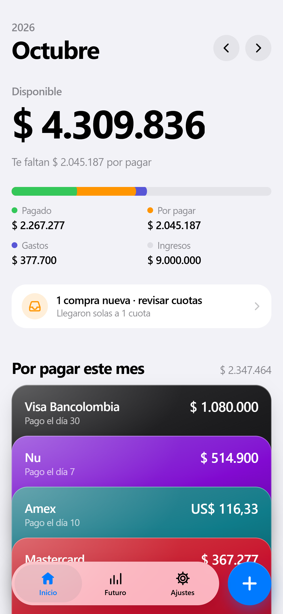
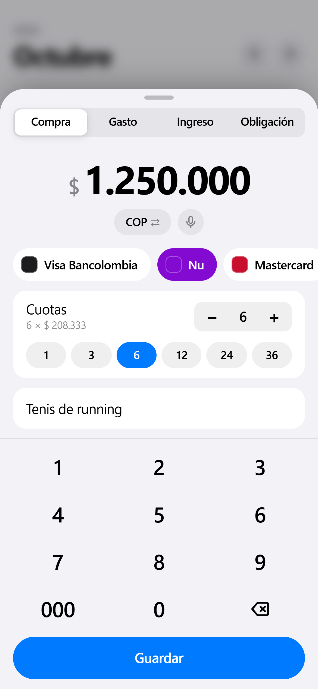
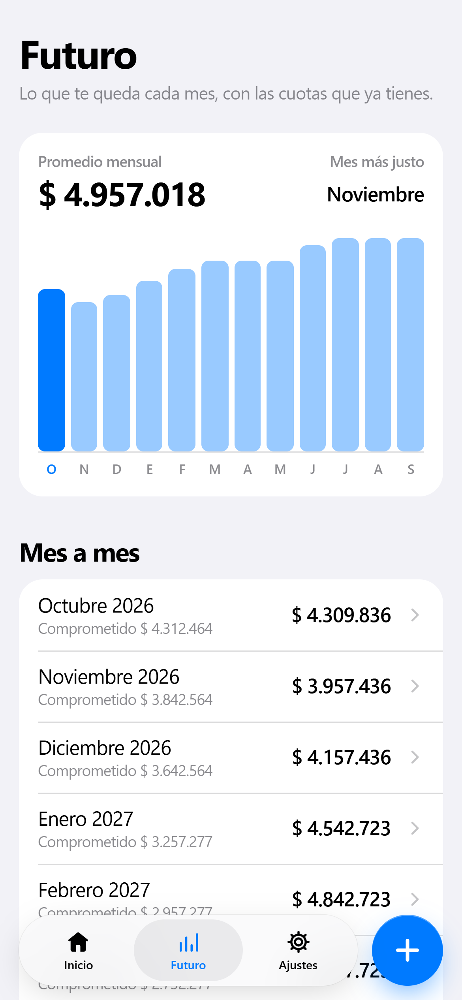
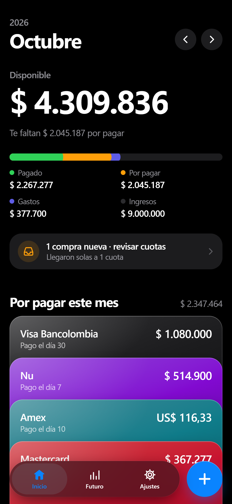
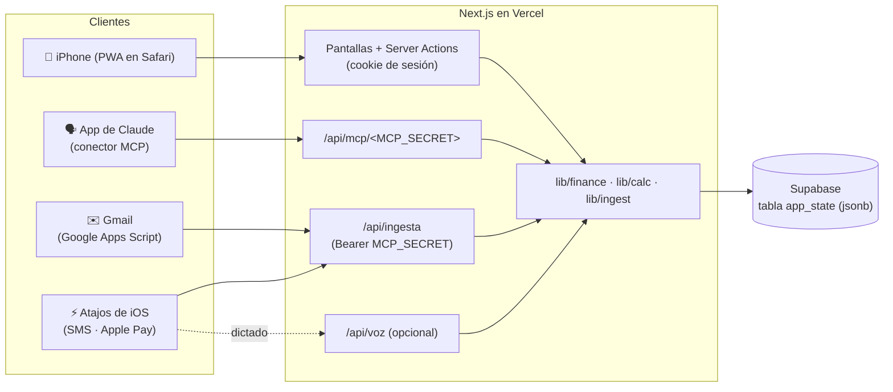

# Disponible

**Cuánta plata te queda de verdad este mes, después de cuotas de tarjeta, cuentas fijas y gastos.** Una app web personal, con estilo de app de iPhone, que puedes actualizar hablándole a Claude o dejar que se llene sola con las alertas de tu banco.

<p align="center">
  
  
  
  
</p>

> Las capturas usan datos de ejemplo ficticios.

[English summary below](#english)

---

## Contenido

- [Qué hace](#qué-hace)
- [Cómo funciona el cálculo](#cómo-funciona-el-cálculo)
- [Stack](#stack)
- [Arquitectura](#arquitectura)
- [Guía de instalación paso a paso](#guía-de-instalación-paso-a-paso)
- [Seguridad](#seguridad)
- [Desarrollo](#desarrollo)
- [Limitaciones conocidas y roadmap](#limitaciones-conocidas-y-roadmap)
- [Licencia](#licencia)
- [English](#english)

---

## Qué hace

- 💰 **Un número claro: el “Disponible” del mes.** Ingresos menos todo lo que ya está comprometido y lo que ya gastaste.
- 💳 **Compras a cuotas con tarjeta de crédito.** Anotas la compra una vez (“TV de 2 millones a 12 cuotas”) y la app reparte cada cuota en su mes. Soporta interés mensual opcional y día de corte.
- 🏠 **Obligaciones fijas.** Arriendo, plan de celular, gimnasio… se descuentan cada mes (con fecha de fin si la tienen).
- 🧾 **Gastos con débito o efectivo.** Se restan del mes en que ocurrieron.
- ✅ **“Por pagar”.** Marca cada tarjeta u obligación como pagada en el mes y ve cuánto falta por pagar.
- 📈 **Futuro.** Proyección de los próximos meses: ves cuándo se liberan las cuotas.
- 🌎 **Varias monedas.** Compras en USD, EUR, etc. se convierten a tu moneda principal (tasas de cambio diarias, con valores de respaldo si no hay internet).
- 📱 **App de iPhone (PWA).** Se instala en la pantalla de inicio desde Safari, a pantalla completa, con animaciones y modo oscuro.
- 🔒 **Contraseña.** Una sola persona, una contraseña (`APP_PASSWORD`).
- 🗣️ **Habla con Claude.** Un servidor MCP para agregar Disponible como *conector personalizado* en Claude: *“Compré un mercado de 450 mil con la Visa a 3 cuotas”*, *“¿cuánto tengo disponible?”*. Funciona en chat y en modo voz desde la app de Claude.
- 🤖 **Registro automático.** Las alertas de compra de tu banco se anotan solas:
  - correos de **Bancolombia** (con un script gratuito de Google Apps Script),
  - **SMS** (p.ej. Nu) y **Apple Pay** (con automatizaciones de Atajos de iOS).
  - Compras con crédito llegan a 1 cuota marcadas como “revisar cuotas”; compras con débito llegan como gastos; transferencias y pagos se ignoran; duplicados se detectan.
- 🎙️ **Dictado (opcional).** Endpoint `/api/voz` para un Atajo de Siri que usa la API de Anthropic.

## Cómo funciona el cálculo

Para cada mes:

```
Disponible = Ingresos
           − Cuotas de tarjetas de crédito que caen en ese mes
           − Obligaciones fijas activas ese mes
           − Gastos con débito / efectivo de ese mes
```

- **Cuotas:** una compra de `monto` a `n` cuotas pone `monto / n` en cada uno de los `n` meses desde el *mes de la primera cuota*. Con interés mensual `r` se usa cuota fija (amortización francesa): `monto·r / (1 − (1+r)^−n)`.
- **Mes de la primera cuota:** el mes de la compra; si la tarjeta tiene **día de corte** y la compra fue después del corte, pasa al mes siguiente.
- **Ingresos:** únicos (solo su mes) o recurrentes (cada mes, con fin opcional).
- **Monedas:** todo se convierte a la moneda principal (Ajustes) antes de sumar.
- **Por pagar:** la parte de cuotas y obligaciones del mes que todavía no marcaste como pagada. Marcar como pagado **no** cambia el Disponible (ese dinero ya estaba comprometido).

El cálculo vive en funciones puras en [`lib/calc.ts`](lib/calc.ts), con pruebas en [`lib/calc.test.ts`](lib/calc.test.ts).

## Stack

| Parte | Tecnología |
| --- | --- |
| Framework | [Next.js 16](https://nextjs.org) (App Router, Server Actions) + React 19 |
| Lenguaje | TypeScript |
| Estilos y animación | Tailwind CSS 4 · [Motion](https://motion.dev) |
| Validación | Zod 4 |
| Datos | [Supabase](https://supabase.com) (Postgres: una sola fila `jsonb`) o archivo local `data/db.json` |
| Claude | [Model Context Protocol](https://modelcontextprotocol.io) SDK (conector) · Anthropic SDK (dictado opcional) |
| Hosting | [Vercel](https://vercel.com) |
| Pruebas | Vitest |

## Arquitectura



- Todos los datos de la app son **un documento JSON** guardado en una fila de Supabase, con control de versión optimista (si Claude y la app escriben a la vez, se reintenta).
- La interfaz, el conector de Claude y el registro automático usan las mismas funciones de [`lib/finance.ts`](lib/finance.ts), así que se comportan igual.

---

## Guía de instalación paso a paso

Esta guía te lleva de cero a tener **tu propia copia** funcionando en tu iPhone, conectada con Claude y (si quieres) registrando compras sola. No necesitas saber programar; sí tener paciencia para copiar y pegar algunos valores. Todo cabe en los planes gratuitos de GitHub, Vercel y Supabase.

> En toda la guía, `https://tu-app.vercel.app` es un ejemplo: cámbialo por la dirección real de tu app.

### 1. Requisitos

- Una cuenta de **[GitHub](https://github.com)** (gratis).
- Una cuenta de **[Vercel](https://vercel.com)** (gratis, plan *Hobby*). Puedes entrar con tu cuenta de GitHub.
- Una cuenta de **[Supabase](https://supabase.com)** (gratis).
- *Opcional:* un plan de pago de **Claude** (Pro, Max, Team o Enterprise) para usar el conector y hablarle a la app.
- *Opcional, solo para probar en tu computador:* **[Node.js 20 o superior](https://nodejs.org)**.

### 2. Haz tu copia del código

- **Fork (recomendado):** arriba a la derecha de este repositorio toca **Fork** → **Create fork**. Ahora tienes una copia en tu cuenta de GitHub.
- O clónalo en tu computador:
  ```bash
  git clone https://github.com/<tu-usuario>/disponible.git
  cd disponible
  ```

### 3. Pruébala en tu computador (opcional)

```bash
npm install
npm run dev
```

Abre <http://localhost:3000>. Sin variables de entorno, la app:

- usa **datos de ejemplo ficticios**, que se guardan en `data/db.json` (se crea solo la primera vez; bórralo para volver a empezar), y
- no pide contraseña (solo en local).

Si quieres probar con contraseña o con tu base de Supabase, copia `.env.example` como `.env.local` y llena los valores (paso 5).

### 4. Crea la base de datos en Supabase

1. Entra a **[supabase.com/dashboard](https://supabase.com/dashboard)** → **New project**.
   - Ponle un nombre (p.ej. `disponible`) y una contraseña de base de datos (guárdala, aunque esta app no la usa).
   - **Región:** elige la más cercana a ti (y a la región de Vercel), p.ej. *São Paulo* o *East US* para Latinoamérica.
   - Espera uno o dos minutos a que el proyecto quede listo.
2. Crea la tabla: en la barra izquierda abre **SQL Editor** → **New query**, pega **todo** el contenido de [`supabase/schema.sql`](supabase/schema.sql) y toca **Run**. Debe decir *Success. No rows returned*.
   - Esto crea la tabla `app_state` y activa **RLS** (Row Level Security) para que nadie pueda leerla con las claves públicas.
3. Copia la **Project URL** (se ve como `https://abcdefghijklmnop.supabase.co`). Tres formas de encontrarla:
   - **Barra de direcciones:** cuando estás dentro del proyecto la dirección es `https://supabase.com/dashboard/project/<ref>`. Tu URL es `https://<ref>.supabase.co`.
   - Botón **Connect** (arriba) → pestaña **App Frameworks** → aparece como `SUPABASE_URL` / `NEXT_PUBLIC_SUPABASE_URL`.
   - **Project Settings** (engranaje) → **Data API** → *Project URL*.
4. Copia la **clave secreta**: **Project Settings** → **API Keys**:
   - Si ves **Secret keys**, copia la que empieza por `sb_secret_…` (toca el ojo o *Reveal*).
   - Si tu proyecto usa las claves antiguas, ve a la pestaña **Legacy API Keys** y copia la **`service_role`** (*secret*).
   - ⚠️ **NUNCA** uses la clave `anon` ni la `publishable` (`sb_publishable_…`): con RLS activo no funcionarán, y no son las que esta app espera.
   - Esta clave salta todos los permisos de la base de datos. Solo va en las variables de entorno del servidor, nunca en el código ni en GitHub.

### 5. Prepara las variables de entorno

| Variable | ¿Obligatoria? | Qué poner |
| --- | --- | --- |
| `APP_PASSWORD` | Sí | La contraseña para entrar a la app. Usa **12 caracteres o más**. Sin ella, en Vercel nadie puede entrar. |
| `MCP_SECRET` | Sí (para Claude y registro automático) | Un secreto largo y aleatorio. Genéralo con el comando de abajo. |
| `SUPABASE_URL` | Sí | La Project URL del paso 4 (`https://<ref>.supabase.co`). |
| `SUPABASE_SERVICE_ROLE_KEY` | Sí | La clave secreta del paso 4 (`sb_secret_…` o la `service_role`). |
| `ANTHROPIC_API_KEY` | No | Solo para el dictado por `/api/voz` (Atajo de Siri). El conector de Claude **no** la necesita. Se obtiene en [console.anthropic.com](https://console.anthropic.com). |

Para generar `MCP_SECRET` (en cualquier terminal con Node instalado):

```bash
node -e "console.log(require('crypto').randomBytes(32).toString('base64url'))"
```

¿Sin Node? Cualquier generador de contraseñas sirve: usa unos 40 caracteres de letras y números (evita `/`, `?`, `#` y espacios, porque el secreto va dentro de una URL).

Guarda estos valores en tu gestor de contraseñas: los necesitarás en los pasos 6, 8 y 9.

### 6. Publica la app en Vercel

**Opción A — Importar desde GitHub (recomendada)**

1. Entra a **[vercel.com/new](https://vercel.com/new)** y conecta tu cuenta de GitHub si te lo pide.
2. Busca tu copia de `disponible` → **Import**.
3. **Framework Preset:** debe aparecer **Next.js** (detectado solo). No cambies los comandos de build.
4. **Antes de tocar Deploy**, abre **Environment Variables** y agrega las variables del paso 5 (nombre y valor, una por una; también puedes pegar el contenido de tu `.env.local`).
5. Toca **Deploy**. En uno o dos minutos tendrás una dirección como `https://tu-app.vercel.app`.
6. Ábrela, entra con tu `APP_PASSWORD` y listo. La primera vez la app arranca **vacía**: agrega tus tarjetas en **Ajustes**.

Cada vez que hagas cambios en GitHub, Vercel vuelve a publicar solo.

**Opción B — Con la terminal (Vercel CLI)**

```bash
npx vercel login          # inicia sesión
npx vercel link           # crea o enlaza el proyecto
npx vercel env add APP_PASSWORD production   # repite para cada variable
npx vercel deploy --prod  # publica
```

**Notas:**

- El archivo [`vercel.json`](vercel.json) fija `"framework": "nextjs"`. Sin él, un proyecto creado desde la CLI puede quedar como “Other” y publicar páginas **404**. No lo borres.
- Si cambias una variable de entorno después, vuelve a publicar (**Deployments** → los tres puntos → **Redeploy**) para que tome efecto.
- Si Vercel muestra la etiqueta **“Needs Attention”** junto a una variable, no es un error: es una sugerencia para marcarla como **Sensitive** (oculta). Es buena idea hacerlo con `SUPABASE_SERVICE_ROLE_KEY`, `MCP_SECRET`, `APP_PASSWORD` y `ANTHROPIC_API_KEY`.

### 7. Instálala en tu iPhone

1. Abre tu dirección (`https://tu-app.vercel.app`) en **Safari** y entra con tu contraseña.
2. Toca el botón **Compartir** (el cuadrado con la flecha hacia arriba).
3. Baja y toca **Agregar a inicio** → **Agregar**.

Queda como una app más: ícono propio, pantalla completa y sesión guardada por un año. En Android funciona igual desde Chrome (**⋮** → **Instalar app**).

### 8. Conéctala con Claude (opcional)

Requiere un plan de pago de Claude. Detalles en [`docs/conectar-claude.md`](docs/conectar-claude.md).

1. En **[claude.ai](https://claude.ai)** → **Configuración** → **Conectores** → **Agregar conector personalizado**.
2. Nombre: `Disponible`. URL:
   ```
   https://tu-app.vercel.app/api/mcp/<MCP_SECRET>
   ```
   (con tu dirección y tu secreto, sin los signos `< >`).
3. Guarda. El conector queda en tu cuenta, así que también aparece en la app de Claude del iPhone.
4. En una conversación, verifica en el menú de herramientas que **Disponible** esté activo. Funciona escribiendo y en **modo voz**. Prueba:
   - *“¿Cuánto tengo disponible este mes?”*
   - *“Compré un mercado de 450 mil con la Visa a 3 cuotas.”*
   - *“Gasté 25 mil en almuerzo.”*
   - *“Me entró el salario de 5 millones, es mensual.”*
   - *“Ya pagué la Mastercard.”*
   - *“¿Cómo voy los próximos 6 meses?”*
   - *“Deshaz lo último.”*
5. La primera vez Claude pide permiso para cada herramienta; puedes elegir **Permitir siempre**.

> Si actualizas la app y se agregan herramientas nuevas, **desconecta y vuelve a conectar** el conector para que Claude las vea.

### 9. Registro automático de compras (opcional)

Guía completa, opción por opción: [`docs/registro-automatico.md`](docs/registro-automatico.md). Todo llega a `POST /api/ingesta` con el mismo `MCP_SECRET`. Resumen:

**Correos de Bancolombia → Google Apps Script** (una sola vez, desde un computador):

1. Entra a [script.google.com](https://script.google.com) con la cuenta de Gmail donde te llegan las alertas → **Nuevo proyecto** → nómbralo `Disponible`.
2. Borra el código de ejemplo y pega **todo** [`integraciones/gmail-bancolombia.gs`](integraciones/gmail-bancolombia.gs). Guarda.
3. ⚙️ **Configuración del proyecto** → **Propiedades de la secuencia de comandos**: crea `DISPONIBLE_URL` = `https://tu-app.vercel.app` (sin `/` al final) y `DISPONIBLE_SECRET` = tu `MCP_SECRET`.
4. En el editor, en la **lista de funciones** de arriba, elige una función y toca **▶ Ejecutar**:
   - `probar` → muestra qué se enviaría de los últimos correos, sin enviar nada.
   - `instalar` → activa la revisión automática cada 5 minutos (pide permisos de Google: *Configuración avanzada → Ir a Disponible (no seguro)* es normal, porque es tu propio script).
   - `reprocesar` → vuelve a enviar los correos de los últimos días (no duplica nada).
   > ⚠️ **Ojo:** **▶ Ejecutar** corre la función **elegida en la lista desplegable**, no la que estás viendo en el código. Revisa siempre que la lista diga la función que quieres.

**SMS (p.ej. Nu) y Apple Pay → Atajos de iOS:** en la app **Atajos** → **Automatización** → **+**:

- **Mensaje** (remitente: tu banco) → *Obtener contenido de URL*: `POST https://tu-app.vercel.app/api/ingesta`, encabezado `Authorization: Bearer <MCP_SECRET>`, cuerpo JSON `{ "canal": "sms", "texto": <Mensaje> }`.
- **Transacción** (Wallet, iOS 17+) → mismo URL, cuerpo `{ "canal": "applepay", "comercio", "monto", "tarjeta" }` con las variables de la transacción.
- Marca **Ejecutar inmediatamente** y agrega *Mostrar notificación* con el campo `mensaje` de la respuesta.

**Bancos soportados:**

- **Bancolombia (correo y SMS):** probado con alertas reales (compras con crédito y débito, pagos, transferencias, pagos recibidos).
- **Nu (SMS):** intérprete **tolerante/genérico**: entiende mensajes del tipo *“Compraste $X en COMERCIO … terminada en 1234”*. Si tus SMS tienen otro formato y no se entienden, quedan en “por revisar” en vez de perderse.
- **Apple Pay:** cualquier banco, porque los datos vienen estructurados de Wallet.
- **¿Otro banco?** Los intérpretes viven en [`lib/ingest/`](lib/ingest/). Crea `lib/ingest/<banco>.ts` siguiendo `bancolombia.ts`, agrega pruebas con ejemplos **anonimizados**, y conéctalo en `interpret()` de [`lib/ingest/index.ts`](lib/ingest/index.ts). Los pull requests son bienvenidos.

Antes del registro automático, en **Ajustes → Tarjetas y fuentes** ponle a cada tarjeta sus **últimos 4 dígitos** (y el día de corte): así cada alerta se asigna sola a su tarjeta.

---

## Seguridad

Disponible está pensada para **una sola persona** con su propio despliegue. Lo que hay y lo que no:

- **Contraseña de la app:** `APP_PASSWORD` protege todas las pantallas y acciones. Al entrar se guarda una cookie `httpOnly`, firmada con HMAC y válida por un año. Cambiar `APP_PASSWORD` cierra todas las sesiones. En Vercel, si falta la contraseña, la app queda **bloqueada** (no abierta).
- **Secreto en la URL del conector:** los conectores personalizados de Claude sin OAuth no permiten enviar cabeceras, así que `MCP_SECRET` va dentro de la URL (`/api/mcp/<MCP_SECRET>`). Trátala como una contraseña: no la compartas ni la pegues en capturas. Puede quedar en registros (logs) de servidores intermedios. Si se filtra, cambia `MCP_SECRET` en Vercel, vuelve a publicar y crea el conector de nuevo. **Trabajo futuro:** OAuth 2.1 según la especificación de autorización de MCP, para no tener que poner el secreto en la URL.
- **`/api/ingesta` y `/api/voz`** usan `Authorization: Bearer <MCP_SECRET>`; las comparaciones son en tiempo constante.
- **Clave de Supabase solo en el servidor:** `SUPABASE_SERVICE_ROLE_KEY` se usa únicamente en código de servidor ([`lib/store.ts`](lib/store.ts)); el navegador nunca habla directo con Supabase.
- **RLS activo:** la tabla `app_state` tiene Row Level Security y se le quitan los permisos a `anon` y `authenticated`, así que las claves públicas de tu proyecto no pueden leerla.
- **Nunca subas `.env.local`** (ni ningún `.env*` con valores) a GitHub. El `.gitignore` ya los excluye; solo `.env.example`, vacío, va en el repositorio. Si alguna vez subiste una clave por error, **cámbiala**: borrar el commit no basta.
- Los datos financieros que guardas son tuyos: viven en tu proyecto de Supabase, no en un servidor compartido.

¿Encontraste un problema de seguridad? Por favor repórtalo de forma privada al dueño del repositorio (GitHub → *Security* → *Report a vulnerability*) en vez de abrir un issue público.

## Desarrollo

### Scripts

| Comando | Qué hace |
| --- | --- |
| `npm run dev` | Servidor de desarrollo en <http://localhost:3000> |
| `npm run build` | Build de producción |
| `npm start` | Corre el build de producción |
| `npm test` | Pruebas con Vitest (`vitest run`) |
| `npm run lint` | ESLint |

También útil: `npx tsc --noEmit` (revisión de tipos).

### Estructura del proyecto

```
.
├── app/
│   ├── (app)/                 # Pantallas con sesión: Inicio, Futuro, Ajustes, detalle de fuente
│   ├── login/                 # Pantalla y acción de login
│   ├── api/
│   │   ├── mcp/[[...path]]/   # Servidor MCP para el conector de Claude
│   │   ├── ingesta/           # Registro automático (correo, SMS, Apple Pay)
│   │   └── voz/               # Dictado con la API de Anthropic (opcional)
│   ├── actions.ts             # Server Actions de la interfaz
│   ├── manifest.ts            # Manifest de la PWA
│   └── pwa-icon/, apple-icon.tsx, icon.svg
├── components/                # UI (inicio, agregar, editar, ajustes, hojas, animaciones)
├── lib/
│   ├── calc.ts                # Cálculo puro del mes y la proyección
│   ├── finance.ts             # Operaciones (agregar, editar, pagar, deshacer, ingesta)
│   ├── store.ts               # Persistencia: Supabase o data/db.json
│   ├── assistant-tools.ts     # Herramientas compartidas por MCP y /api/voz
│   ├── ingest/                # Intérpretes de alertas (bancolombia, nu) y reglas
│   ├── session.ts             # Cookie de sesión (APP_PASSWORD)
│   ├── secret-auth.ts         # Verificación de MCP_SECRET
│   ├── fx.ts, convert.ts      # Tasas de cambio y conversión
│   ├── seed.ts                # Datos de ejemplo ficticios (solo local)
│   └── types.ts, schemas.ts   # Tipos y validación (Zod)
├── integraciones/
│   └── gmail-bancolombia.gs   # Google Apps Script para correos del banco
├── supabase/schema.sql        # Tabla app_state + RLS
├── docs/                      # Guías: conectar Claude, registro automático, capturas
├── proxy.ts                   # Protege las rutas con la sesión (antes "middleware")
└── vercel.json                # Fija el framework Next.js en Vercel
```

### Pruebas

```bash
npm test
```

Cubren el cálculo de cuotas y del disponible, meses y monedas, las operaciones de `lib/finance.ts` y los intérpretes de alertas con ejemplos anonimizados (`lib/**/*.test.ts`). Si agregas un banco o cambias el cálculo, agrega pruebas.

### Notas para quien contribuye

- Esta versión de Next.js (16) tiene cambios importantes respecto a versiones anteriores (p.ej. `proxy.ts` en lugar de `middleware.ts`). La documentación de la versión instalada está en `node_modules/next/dist/docs/`.
- `AGENTS.md` / `CLAUDE.md` tienen instrucciones para asistentes de código (Claude Code y similares).
- Los textos de la app y del código están en español.

## Limitaciones conocidas y roadmap

**Limitaciones de hoy**

- **Un solo usuario** por despliegue (una contraseña, un documento de datos).
- El conector de Claude se autentica con un **secreto en la URL**, no con OAuth.
- Registro automático por correo solo para **Bancolombia**; el intérprete de SMS de Nu es genérico.
- Moneda y textos pensados para **Colombia** (COP por defecto, hora de Bogotá para fechar alertas), aunque la moneda principal se puede cambiar.
- Sin notificaciones push propias (los Atajos de iOS muestran la confirmación).

**Roadmap**

- [ ] OAuth 2.1 para el conector MCP.
- [ ] Más bancos (correo y SMS) y más países.
- [ ] Notificaciones (recordatorios de pago, alertas de presupuesto).
- [ ] Varios usuarios / hogares compartidos.

¿Quieres ayudar? Abre un issue o un pull request.

## Licencia

[MIT](LICENSE). Úsala, modifícala y compártela libremente.

---

## English

**Disponible** (Spanish for *“available”*) is a personal-finance PWA that answers one question: **how much money do I really have left this month?**

`Available = income − credit-card installments due this month − fixed monthly obligations − debit/cash expenses`

- Credit-card purchases are split into monthly installments (optional interest and statement cut-off day); fixed obligations and recurring income repeat monthly; multi-currency with daily exchange rates; a forward projection shows when installments end.
- iPhone-style installable PWA (Safari → Share → Add to Home Screen), dark mode, single-user password login.
- **Talk to it from Claude:** a built-in MCP server (`/api/mcp/<MCP_SECRET>`) can be added as a custom connector in claude.ai (paid plan) and used in chat or voice mode.
- **Automatic capture:** Bancolombia email alerts via Google Apps Script, SMS and Apple Pay via iOS Shortcuts, all posted to `/api/ingesta`. Parsers live in `lib/ingest/` — adding another bank means a new parser plus tests.
- **Stack:** Next.js 16 (App Router), React 19, TypeScript, Tailwind CSS 4, Motion, Zod 4, Supabase (single `jsonb` row with RLS) or a local JSON file, deployed on Vercel.

**Quick start:** `npm install && npm run dev` runs locally with fictional demo data, no configuration needed. To deploy: create a Supabase project and run `supabase/schema.sql`, then import the repo on Vercel with `APP_PASSWORD`, `MCP_SECRET`, `SUPABASE_URL`, `SUPABASE_SERVICE_ROLE_KEY` (and optionally `ANTHROPIC_API_KEY`). The step-by-step guide above (in Spanish) covers every click; see also `.env.example`.

The UI and docs are in Spanish; contributions (including translations and new bank parsers) are welcome. Licensed under MIT.
